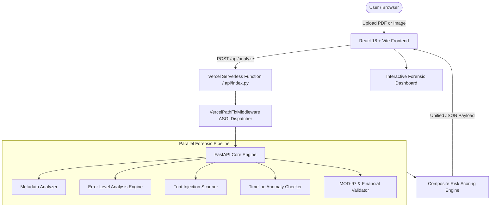

# 🧾 FraudCheck — Tampered Invoice & Digital Document Forensics

[](https://fraudcheck-taupe.vercel.app)
[](https://github.com/Akhil-Binu/fraudcheck/packages)
[](https://github.com/Akhil-Binu/fraudcheck/pkgs/container/fraudcheck)
[](https://fraudcheck-taupe.vercel.app/docs)
[](https://github.com/Akhil-Binu/fraudcheck)
[](https://python.org)
[](https://react.dev)
[](https://tailwindcss.com)
[](LICENSE)

> **Enterprise-grade document forensics platform designed to detect invoice spoofing, digital document tampering, wire detail redirection, and retroactive backdating.**

---

## 🌐 Live Deployment & Links

- **🚀 Live Web Application:** [https://fraudcheck-taupe.vercel.app](https://fraudcheck-taupe.vercel.app)
- **📦 GitHub Packages:** [https://github.com/Akhil-Binu/fraudcheck/packages](https://github.com/Akhil-Binu/fraudcheck/packages)
  - **Docker Container (GHCR):** `docker pull ghcr.io/akhil-binu/fraudcheck:latest`
  - **npm Package:** `npm install @akhil-binu/fraudcheck`
- **📖 Interactive API Docs (Swagger):** [https://fraudcheck-taupe.vercel.app/docs](https://fraudcheck-taupe.vercel.app/docs)
- **🩺 API Health Check:** [https://fraudcheck-taupe.vercel.app/api/health](https://fraudcheck-taupe.vercel.app/api/health)
- **🐙 GitHub Repository:** [https://github.com/Akhil-Binu/fraudcheck](https://github.com/Akhil-Binu/fraudcheck)

---

## 🚨 The Real-World Problem: Invoice Spoofing & BEC

Every year, small businesses, accounting departments, and freelancers lose billions of dollars to **Business Email Compromise (BEC)** and **Invoice Spoofing Scams**:

1. **Email Interception**: Attackers intercept legitimate supplier invoices via compromised corporate mailboxes or man-in-the-middle relays.
2. **Silent Document Forgery**: Using tools like Adobe Photoshop, Acrobat, or PDF text splicing utilities, attackers alter only the payment destination — replacing the legitimate IBAN, IFSC code, or wire beneficiary with an offshore or mule account.
3. **Flawless Visual Appearance**: The invoice layout, company logos, line items, and invoice numbers remain visually untouched, easily deceiving busy accounts payable teams.
4. **Catastrophic Payouts**: The invoice is paid, and the funds are irrevocably transferred into an attacker-controlled account before anyone realizes the switch.

**FraudCheck** acts as an automated digital forensic expert that inspects uploaded invoices across multiple independent forensic vectors in milliseconds.

---

## 🔬 Core Forensic Capabilities

```
┌────────────────────────────────────────────────────────────────────────┐
│                          FRAUDCHECK FORENSIC SUITE                     │
├───────────────────┬───────────────────┬──────────────────┬─────────────┤
│   Visual Error    │   PDF Metadata    │  Font Injection  │  Checksum   │
│  Level Analysis   │   & Software      │   & Splicing     │  Validation │
│     (ELA)         │   Footprints      │    Detection     │  (MOD-97)   │
└───────────────────┴───────────────────┴──────────────────┴─────────────┘
```

### 1. 🔍 Visual Error Level Analysis (ELA)
- **Compression Artifact Disparity**: Re-compresses the document image at a strictly controlled 95% JPEG quality and computes the absolute pixel difference:
  $$\Delta(x, y) = |I_{\text{original}}(x, y) - I_{\text{recompressed}}(x, y)| \times 20$$
- **JET Colormap Heatmap**: Highlights regions that were spliced, modified, or pasted into the document at a different compression level or resolution.
- **Contour & Anomaly Detection**: Locates localized high-error clusters (such as pasted bank numbers or spliced invoice totals) and counts anomalous regions.
- **Serverless Resilience**: Includes an accelerated OpenCV engine with an automatic pure NumPy/Pillow fallback for containerless serverless runtimes.

### 2. 🕵️ Metadata & Ghost Footprint Analysis
- **Software Signature Detection**: Inspects PDF dictionaries and EXIF headers for traces of editing suites (Adobe Photoshop, GIMP, Inkscape, Foxit PhantomPDF, Nitro Pro, etc.).
- **Asymmetric Metadata Identification**: Detects documents where a `ModDate` (Modification Date) exists but the `CreationDate` has been stripped or sanitized by an editor.
- **Producer / Creator Discrepancies**: Flags instances where creator metadata is stripped while modified by generic or third-party PDF producer engines (e.g. `3.0.39 (5.1.26)`).
- **Date Drift Flagging**: Calculates drift between creation and modification timestamps, flagging non-atomic saves.

### 3. 🔤 Font Subset Injection & Intruder Detection
- **Intruder Font Subsets**: Splicing tools frequently inject isolated font subsets (e.g., `AAAAXO+DejaVuSans-Bold`) to insert rogue characters or numbers into an invoice whose base font is `DejaVuSans-Bold`.
- **Catalogue Inspection**: Extracts all embedded font descriptors per page via PyMuPDF and cross-references font subset prefixes (`[A-Z]{6}\+`) to identify tampered text insertions.

### 4. ⏳ Forensic Timeline Verification & Backdating Check
- **Printed Invoice Date Extraction**: Intelligently parses invoice issuance dates printed on the document face (`DD-MM-YYYY`, `DD/MM/YYYY`, `MMMM DD, YYYY`, etc.).
- **Timeline Delta Check**: Computes the delta between the printed invoice date and the PDF file's last modified timestamp:
  $$\Delta t = t_{\text{PDF Modified}} - t_{\text{Invoice Date}}$$
- **Retroactive Tampering Alarm**: Flags backdating anomalies (e.g. an invoice dated *February 2021* but modified in *November 2026* — over 5.7 years later).

### 5. 💳 Financial Identifier & Checksum Validation
- **IBAN Checksum**: Full ISO 7064 / ISO 13616 MOD-97 algorithm:
  $$\text{Checksum} = \text{MOD-97}(\text{Alphanumeric Expanded IBAN}) == 1$$
- **IFSC Format**: Verifies Indian Financial System Codes against RBI structural specifications (`^[A-Z]{4}0[A-Z0-9]{6}$`).
- **GSTIN Check Digit**: Validates Indian Goods & Services Tax Identification Numbers (15-character alphanumeric format with check-digit modulus algorithm).
- **PAN Verification**: Permanent Account Number verification with entity category validation (`^[A-Z]{5}[0-9]{4}[A-Z]$`).
- **UPI ID / VPA**: Validates Virtual Payment Address formats (`name@bank`).
- **Contact Integrity**: Parses and verifies phone numbers and emails.

---

## ⚖️ Composite Risk Scoring Engine

Every document receives an objective risk score from `0.0` to `100.0`, segmented into four risk tiers:

| Tier | Score Range | Badge Color | Implication |
| :--- | :---: | :---: | :--- |
| **LOW** | 0 – 24 | 🟢 Green | Authentic document; consistent metadata and valid financial checksums. |
| **MEDIUM** | 25 – 49 | 🟡 Amber | Minor anomalies detected (e.g. mild compression variance or unverified formats). |
| **HIGH** | 50 – 74 | 🟠 Orange | Strong indicators of tampering (e.g. Photoshop editor footprint, invalid IBAN). |
| **CRITICAL** | 75 – 100 | 🔴 Red | Verified fraud (e.g. font injection, 5+ year timeline gap, failed checksums). |

```
                       COMPOSITE RISK FORMULA
  Score = w_meta * Score_meta + w_ela * Score_ela + w_val * Score_val
  * Override rules boost score to ≥ 80.0 upon critical font injection or backdating.
```

---

## 🏗️ Architecture & Tech Stack



### Backend
- **Python 3.12** / **FastAPI**: Asynchronous, high-performance web framework.
- **PyMuPDF (`fitz`)**: Low-level PDF document parsing, page rasterization, and font catalogue inspection.
- **OpenCV (`opencv-python-headless`) & Pillow (`PIL`)**: High-speed image transformation, JPEG error amplification, and JET colormap rendering.
- **NumPy**: Matrix math for ELA differential calculations.
- **Pydantic v2**: Type validation and dual-aliased serializable response models.

### Frontend
- **React 18** + **Vite**: Ultra-fast component rendering and HMR.
- **Tailwind CSS**: Custom dark cybersecurity visual design system.
- **Lucide React**: Modern iconography.
- **Canvas / Image Modals**: Full-screen inspectable visual ELA viewers.

### Cloud Infrastructure
- **Vercel Serverless**: Fluid compute ASGI runtime (`@vercel/python`) with zero cold-start bottlenecks and automated global edge asset distribution.

---

## 📁 Repository Structure

```
Fraudcheck/
├── api/
│   ├── index.py                  # Vercel ASGI serverless entrypoint & path fixer
│   └── requirements.txt          # Serverless Python dependencies
├── backend/
│   ├── main.py                   # FastAPI server, endpoints, CORS & local static mount
│   ├── models.py                 # Pydantic schemas (AnalysisResponse, ELAResult, etc.)
│   ├── requirements.txt          # Local environment dependencies
│   └── analyzers/
│       ├── ela.py                # Error Level Analysis & JET heatmap generator
│       ├── metadata.py           # Metadata, editor footprints & font subset scanning
│       ├── text_extractor.py     # PyMuPDF text & financial identifier extraction
│       └── validator.py          # MOD-97 IBAN, IFSC, GSTIN, PAN validation algorithms
├── frontend/
│   ├── package.json              # React dependencies
│   ├── vite.config.js            # Vite build configuration & API reverse proxy
│   ├── tailwind.config.js        # Dark cyber styling system
│   └── src/
│       ├── App.jsx               # Application controller & state machine
│       ├── api.js                # Axios client for analysis requests
│       └── components/
│           ├── Header.jsx        # Branding & live status indicators
│           ├── UploadZone.jsx    # Drag-and-drop zone + 1-click forensic sample cards
│           ├── AnalysisDashboard.jsx # Tabbed forensic reports container
│           ├── RiskScore.jsx     # Animated SVG radial gauge (Low → Critical)
│           ├── MetadataPanel.jsx # PDF header & editor footprint inspector
│           ├── ELAViewer.jsx     # Side-by-side original vs ELA heatmap viewer
│           ├── ValidationPanel.jsx # Banking & tax identifier check results
│           └── TextPanel.jsx     # Multi-page text viewer with copy tools
├── samples/
│   ├── legitimate_invoice.pdf    # Clean business invoice (Clean MOD-97 IBAN)
│   ├── tampered_invoice.pdf      # Attacker edited with Photoshop + Fake IBAN
│   ├── bfl_tampered_invoice.pdf  # Real-world Bajaj Finance invoice with font injection
│   └── spliced_invoice.jpg       # Scanned image invoice with spliced account box
├── vercel.json                   # Vercel deployment configuration & routing rules
├── package.json                  # Root monorepo script aggregator
└── README.md                     # Comprehensive project documentation
```

---

## 🚀 Getting Started Locally

### Prerequisites
- **Python 3.10+** (Python 3.12 recommended)
- **Node.js 18+** & **npm**

### 1. Clone the Repository
```bash
git clone https://github.com/Akhil-Binu/fraudcheck.git
cd fraudcheck
```

### 2. Backend Setup
```bash
cd backend
python -m venv venv

# Windows (PowerShell):
.\venv\Scripts\Activate.ps1
# macOS / Linux:
source venv/bin/activate

pip install -r requirements.txt
uvicorn main:app --host 0.0.0.0 --port 8000 --reload
```
The FastAPI backend will be live at `http://localhost:8000` with Swagger docs at `http://localhost:8000/docs`.

### 3. Frontend Setup
In a new terminal:
```bash
cd frontend
npm install
npm run dev
```
Open `http://localhost:5173` in your browser. The Vite development proxy will automatically route all `/api/*` calls to `http://localhost:8000`.

---

## 📡 API Reference

### 1. Analyze Document
**`POST /api/analyze`**

Accepts a multipart file upload (`.pdf`, `.png`, `.jpg`, `.jpeg`, `.tiff`, `.webp`).

#### Example Request (cURL):
```bash
curl -X POST "https://fraudcheck-taupe.vercel.app/api/analyze" \
  -H "accept: application/json" \
  -F "file=@invoice_sample.pdf"
```

#### Example Response (JSON):
```json
{
  "filename": "bfl_tampered_invoice.pdf",
  "file_type": "pdf",
  "overall_risk_score": 80.0,
  "overall_risk_level": "critical",
  "suspicious_flags": [
    "Asymmetric metadata: Modification timestamp present but creation date is stripped",
    "Stripped application metadata: Creator is empty while modified by engine '3.0.39 (5.1.26)'",
    "Font injection detected on Page 1: Injected font subset 'AAAAXO+DejaVuSans-Bold' coexists with base font",
    "Critical timeline mismatch: Invoice date is 21-02-2021, but PDF modified on 2026-11-02 (~5.7 years later)",
    "Localized compression artifact disparity (max diff: 67.3)"
  ],
  "metadata": {
    "creator": null,
    "producer": "3.0.39 (5.1.26)",
    "creation_date": null,
    "modification_date": "D:20261102171405+01'00'",
    "page_count": 2,
    "file_size": "139.9 KB",
    "risk_level": "high"
  },
  "ela": {
    "max_difference": 67.3,
    "mean_difference": 0.42,
    "suspicious_regions": 1,
    "risk_level": "medium",
    "heatmap_base64": "iVBORw0KGgoAAAANSUhEUg..."
  },
  "validation": {
    "matches": [
      {
        "type": "GSTIN",
        "value": "32AAACB0000A1Z5",
        "valid": true,
        "details": "Format valid (Kerala, Private Limited Company)"
      }
    ],
    "risk_level": "low"
  }
}
```

### 2. Preloaded Forensic Demo Samples
**`GET /api/samples`** — Returns list of preloaded samples.  
**`POST /api/analyze-sample/{sample_id}`** — Instantly executes full forensic analysis on a built-in sample document.

---

## 🔒 Security & Privacy by Design

- **Zero Document Retention**: Files analyzed via the web interface or API are processed in volatile temporary memory and deleted immediately after analysis. No customer invoices are stored on disk or persistent databases.
- **Safe Parsing**: Employs sandboxed PyMuPDF and Pillow decoders to defend against malicious PDF exploit payloads and buffer overflow attempts.
- **CORS Configured**: Strict cross-origin request policies with configurable origin restrictions for corporate deployments.

---

## 📄 License

This project is licensed under the **MIT License** — see the [LICENSE](LICENSE) file for details.

---

## 👨‍💻 Author

**Akhil Binu**  
- **GitHub:** [@Akhil-Binu](https://github.com/Akhil-Binu)  
- **Project Repository:** [https://github.com/Akhil-Binu/fraudcheck](https://github.com/Akhil-Binu/fraudcheck)
- **Live Demo:** [https://fraudcheck-taupe.vercel.app](https://fraudcheck-taupe.vercel.app)
